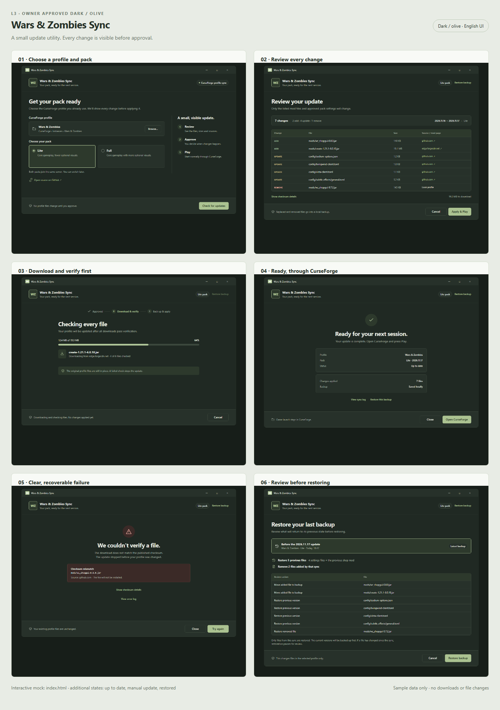

# L3 — UI design proposal

**Approved by the owner on 18 November 2026: English flow and dark / olive.** This is an offline HTML prototype, not the WPF app or sync engine. The owner requested L3 before L2; no Core implementation is included in this PR.

## Open and review

Open [index.html](index.html) locally in a browser. No server, package install, login or network access is needed. The review toolbar above the window switches screens and visual alternatives. In-app buttons simulate transitions; Browse, logs, Close and Open CurseForge display a prototype notice instead of opening dialogs/apps or changing files. External source/mod-page links navigate only when explicitly clicked.

Suggested review sequence: Profile → Change list → Progress → Applying → Ready → Restore → Restored. Also inspect Error, Up to date and Manual update. These are separate, selectable example states, not a real running sync.

The overview is for orientation; the full-size screen links below and interactive mock are the review artifacts for text/details.

| Required view | Preview | Decision shown |
|---|---|---|
| First run | [Profile and pack](previews/setup.png) | Existing profile / Browse; Lite vs Full; check updates before approval |
| Change list | [Changes](previews/changes.png) | Every path, ADD/UPDATE/REMOVE, size, source/mod link, optional old/proposed SHA256 detail for every row, Cancel or Apply & Play |
| Progress | [Download](previews/progress.png), [Applying](previews/applying.png) | Download/verify first; backup/apply later; Cancel only before applying |
| Done | [Ready](previews/done.png) | Explicit completion and backup receipt; hand off to CurseForge |
| Error | [Verification error](previews/error.png) | Failed hash stops before apply; details/log/retry |
| Restore | [Restore preview](previews/restore.png) | All seven undo actions, scoped backup, explicit Restore button |

Additional edge states: [Up to date](previews/current.png), [Manual required](previews/manual.png), [Restored](previews/restored.png).

## Visual direction

Alternative: **light / olive** — a quiet Windows utility with pale surfaces, Segoe UI, restrained status colors and a muted olive action. Intended to make the change list readable and the approval action unambiguous.

Approved default: **dark / olive** — same layout/flow, closer to the pack's military visual identity. Compare [dark first run](previews/setup-dark.png) and [dark change list](previews/changes-dark.png), or use the review toolbar. The theme switch is a design-review control, not a commitment to ship a theme-settings feature.

UI copy is English, matching existing player-facing pack content. Icon paths and WZ lettering are original inline SVG/text; there are no borrowed screenshots, logos, external fonts or background images.

## Interaction contract proposed for implementation

- Profile selection/checking does not change pack files. The player chooses Full/Lite and reviews the plan.
- Only the displayed managed mod/config paths can change. The fixture shows two additions, four updates and one removal; versioned JAR replacement is honestly shown as ADD plus REMOVE, not an inferred in-place update.
- Sources are visible. Hash details are optional so the main flow stays concise. Checksum integrity is distinguished from publisher identity.
- Apply & Play is the explicit approval boundary. All downloads and checks finish before backing up/applying changes. The applying state disables Cancel and Restore to avoid competing operations.
- Required manual files block Apply & Play; the player sees the reason, mod-page route and re-check action. No false Up to date/Ready state.
- A verification failure leaves current profile files in place. Once applying has started, failure/recovery will require L2 transaction/journal behavior; this prototype does not demonstrate a rollback implementation.
- Done/Up to date opens CurseForge; the player uses its normal Play flow. The sync app exits in the eventual app, with no background service.
- Restore previews all original sync actions: restore the five prior files and move the two additions out to backup. Current versions are backed up first; files modified since sync pause for review. This is proposed behavior for Core, not a tested recovery engine.
- Restored means the previous pack version, not current server readiness. The next action is Check for updates, not a misleading Play-ready status.

## Fixture and verification limits

Everything is sample data. The profile label/path suffix is generic; no real discovery, personal path, server address, login or file content is included. Pack choice updates the labels; the demonstration file list is fixed and is not a real Full/Lite diff. File-size/progress figures are illustrative; the shop/Create hashes are public artifact checksums; other displayed hashes are illustrative fixtures. Manual/error scenarios do not claim a current live distribution or download check.

Verified in an isolated local headless Edge profile: all displayed states render, screenshots were inspected, inline JavaScript parses as UTF-8, and a 16-check browser interaction smoke pass covers pack selection, exact seven-row list, complete per-file checksum toggle, approval/cancel navigation, ready handoff, complete restore preview, previous-version receipt, verification error detail, manual gating, up-to-date handoff and theme selection. No sync, browser download, game launch, file-picker/log action or restore was executed.

Not verified: native WPF rendering, high-DPI/screen-reader behavior, real file/network safety, cancellation/recovery semantics, actual source metadata, game import/join. Those belong to later implementation/review; L2 MUST security rules remain mandatory regardless of visual approval.

## Owner approval

The owner approved the English flow and dark / olive direction on 18 November 2026. Dark is now the prototype default and the required-view screenshots use it. Light remains a review alternative. The owner also selected .NET 10 LTS for L2, superseding the earlier .NET 8 plan. Core remains a separate PR; L4 wiring is a later stage.
